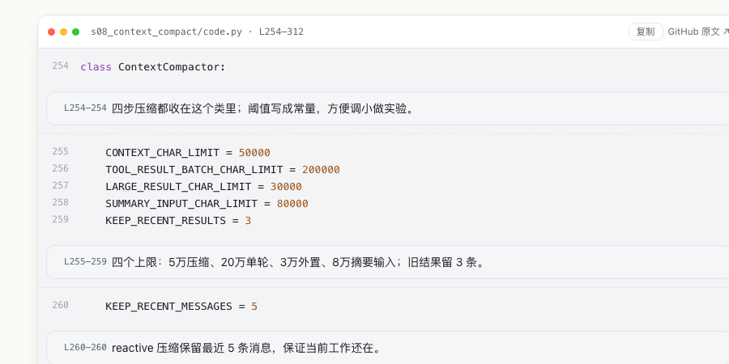

# Learn Claude Code · 大白话教程

用大白话读懂 Agent 的循环、工具、上下文与协作机制。

**在线阅读：<https://liancheng2020.github.io/learn-claude-code-notes-zh/>**



## 适合谁 · 能学到什么

会一点 Python、想搞懂 Agent 到底怎么跑起来，或正在读 [learn-claude-code](https://github.com/shareAI-lab/learn-claude-code) 却被术语卡住的人。

17 章从循环、工具、权限、hook、todo，讲到子 Agent、上下文压缩、记忆、任务、后台、定时、多 Agent、MCP、Workflow 和目标循环。每章按「问题 → 思路 → 代码分段讲解 → 边界与练习」展开，并区分**本版实现 / 教学简化 / 生产建议**。

## 实际讲解范围

| 章节    | 代码     | 讲解方式                    |
| ------- | -------- | --------------------------- |
| s01–s02 | 完整源码 | 关键行注解                  |
| s03–s08 | 核心节选 | 节选内关键行注解            |
| s09–s17 | 关键片段 | 片段内关键行注解 + 分段说明 |

- 全站 **17 章，配有关键代码注解**；不是逐行注释，也不是全文翻译。
- 没注解的行留给你对照原文读；代码块标 `L起–L止`，可对照固定 commit。

## 这不是什么

- **非官方**社区教程，不代表 Anthropic 或 Claude Code 团队；**不是官方源码、官方文档，也不是命令行使用手册。**
- 讲的是教学仓库 `shareAI-lab/learn-claude-code`，不含 Claude Code 产品源码；示例是教学实现，上生产需自行补配置、隔离、指标和停机。

## 本地阅读

在线版不需要 API Key。仓库已带构建好的 `site/`：

```bash
git clone https://github.com/liancheng2020/learn-claude-code-notes-zh.git
cd learn-claude-code-notes-zh
python3 -m http.server -d site 8000     # http://localhost:8000
```

只有修改 `content/`、需要重新构建时，才要准备上游源码（见文末）。

## 纠错与许可

讲错、行号对不上、例子跑不通，欢迎提 [Issue](https://github.com/liancheng2020/learn-claude-code-notes-zh/issues)，写清章节和行号即可。

讲解文字由 AI 辅助、人工校对；代码片段遵循上游 MIT，讲解为 CC BY 4.0，见 [NOTICE](NOTICE) / [LICENSE](LICENSE)。上游固定 commit `7226f555d48900076eba126acf37c9ed5f002b5d`（2026-10-27）。

## 构建与测试

<details>
<summary>克隆、构建、测试（Python 3.10+，只用标准库）</summary>

```bash
git clone https://github.com/liancheng2020/learn-claude-code-notes-zh.git
cd learn-claude-code-notes-zh
git clone https://github.com/shareAI-lab/learn-claude-code.git ../learn-claude-code
git -C ../learn-claude-code checkout 7226f555d48900076eba126acf37c9ed5f002b5d

python3 build.py --src ../learn-claude-code --out site

python3 -m unittest discover -s tests -v
python3 tests/check_site.py site --src ../learn-claude-code
python3 tests/lint_notes.py --src ../learn-claude-code
python3 tests/ui_smoke.py --site site        # 需要 Chrome
```

构建会校验上游 HEAD 与固定 commit 一致；`--out` 拒绝项目根、上游根、`$HOME` 和 `/`。

</details>
